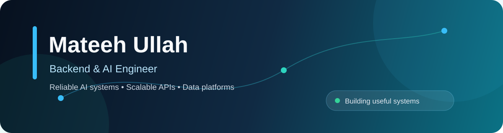

  

  <a href="https://mateehullah.github.io/">Portfolio</a> ·
  <a href="https://www.linkedin.com/in/mateeh-ullah/">LinkedIn</a> ·
  <a href="https://github.com/pulls?q=is%3Apr+author%3AMateehUllah">Pull requests</a>

## About

I work on Python backend applications and AI-related projects, and I'm learning through contributions to open-source projects. My interests include APIs, developer tooling, testing, and machine learning.

## Projects

- [SereniMind](https://github.com/MateehUllah/SereniMind)
- [Automated Root Cause Analysis](https://github.com/MateehUllah/Automated-Root-Cause-Analysis)
- [AI Connectivity: Healthcare & Education](https://github.com/MateehUllah/ai-connectivity-healthcare-education)
- [Backend Coach — AI Hackathons](https://github.com/MateehUllah/backend_coach-ai-hackathons)

## Open-source activity

A selection of pull requests I've opened. Check each PR for its current review and merge status.

- [PySyft #9526](https://github.com/OpenMined/PySyft/pull/9526)
- [PyHealth #1241](https://github.com/sunlabuiuc/PyHealth/pull/1241)
- [local-deep-research #6745](https://github.com/LearningCircuit/local-deep-research/pull/6745)
- [django-ledger #191](https://github.com/arrobalytics/django-ledger/pull/191)
- [Microsoft Python Environments #1926](https://github.com/microsoft/vscode-python-environments/pull/1926)

[All authored pull requests](https://github.com/pulls?q=is%3Apr+author%3AMateehUllah)

## Git pulse

Activity links for a transparent view of ongoing work (not a measure of code quality):

- [GitHub contributions](https://github.com/MateehUllah?tab=overview)
- [Pull requests](https://github.com/pulls?q=is%3Apr+author%3AMateehUllah)
- [Issues](https://github.com/issues?q=is%3Aissue+author%3AMateehUllah)
- [GHFind activity breakdown](https://ghfind.com/en/u/MateehUllah)

## Contribution trail

  <picture>
    <source media="(prefers-color-scheme: dark)" srcset="https://raw.githubusercontent.com/MateehUllah/MateehUllah/output/github-contribution-grid-snake-dark.svg" />
    <source media="(prefers-color-scheme: light)" srcset="https://raw.githubusercontent.com/MateehUllah/MateehUllah/output/github-contribution-grid-snake.svg" />
    
  </picture>

