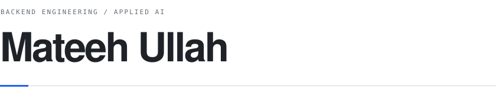

<picture>
  <source media="(prefers-color-scheme: dark)" srcset="./assets/masthead-dark.svg" />
  <source media="(prefers-color-scheme: light)" srcset="./assets/masthead-light.svg" />
  
</picture>

I build Python backends and AI applications, with a focus on reliable APIs, retrieval systems, and developer tools.

[Portfolio ↗](https://mateehullah.github.io/) &nbsp; · &nbsp; [LinkedIn ↗](https://www.linkedin.com/in/mateeh-ullah/) &nbsp; · &nbsp; [Email ↗](mailto:mateehullah89@gmail.com)

 

### Selected work

**[SereniMind](https://github.com/MateehUllah/SereniMind)** Conversational AI with persistent chat history and local model inference. FastAPI · React · Ollama

**[Network RCA](https://github.com/MateehUllah/Automated-Root-Cause-Analysis)** Network monitoring and troubleshooting with machine learning and a voice interface. Python · Streamlit · Whisper

**[AI for Connectivity](https://github.com/MateehUllah/ai-connectivity-healthcare-education)** Predictive models for healthcare and education connectivity needs. Flask · React · scikit-learn

 

### Open source

Merged contributions to [Open Library](https://github.com/internetarchive/openlibrary/pull/14224), [PySyft](https://github.com/OpenMined/PySyft/pull/9529), and [Kornia](https://github.com/kornia/kornia/pull/5366).

[Explore my pull requests →](https://github.com/pulls?q=is%3Apr+author%3AMateehUllah)

 
Python &nbsp; / &nbsp; FastAPI &nbsp; / &nbsp; Django &nbsp; / &nbsp; PostgreSQL &nbsp; / &nbsp; Redis &nbsp; / &nbsp; Docker
